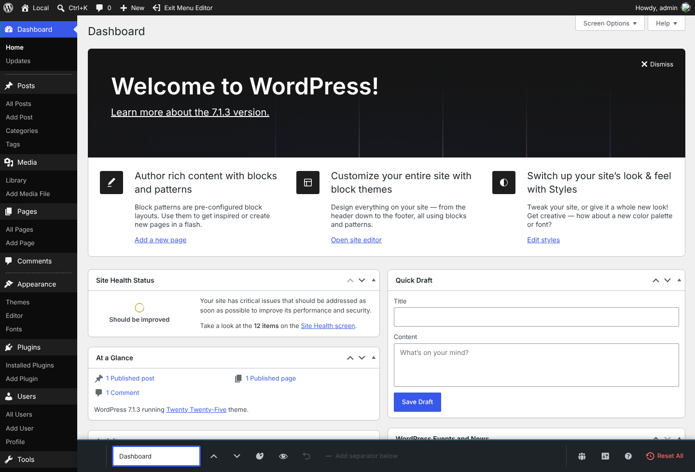
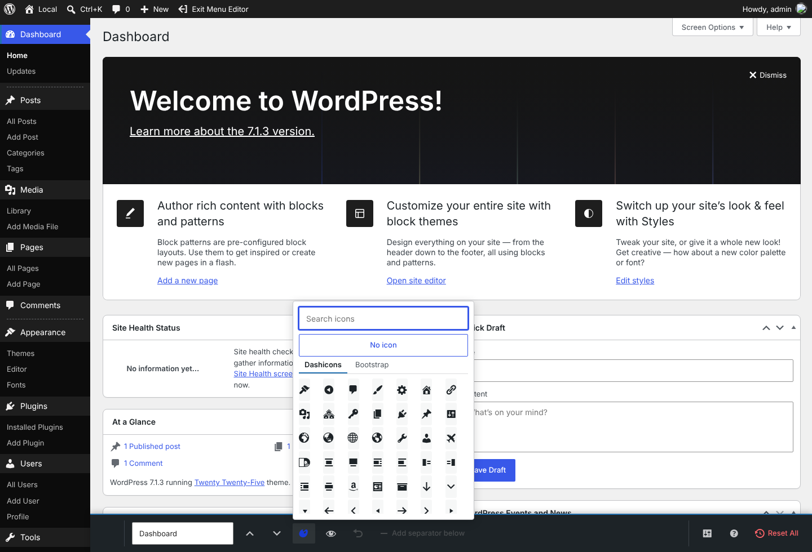
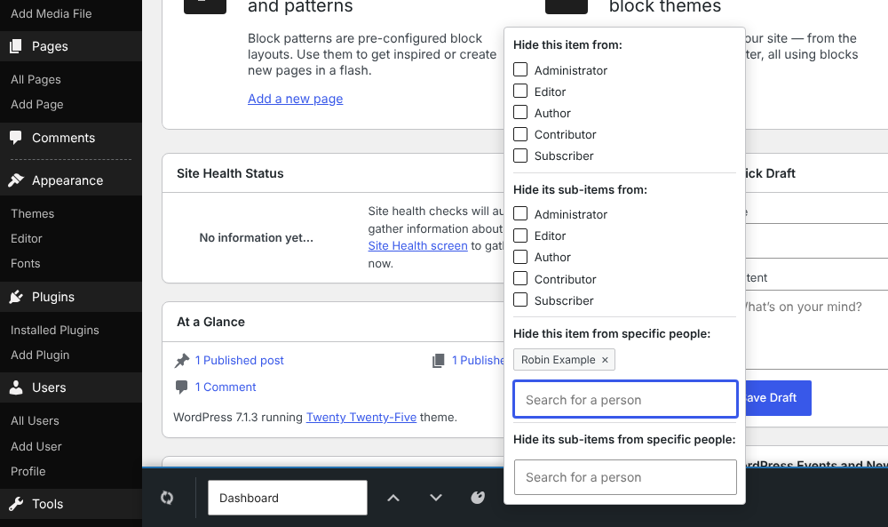
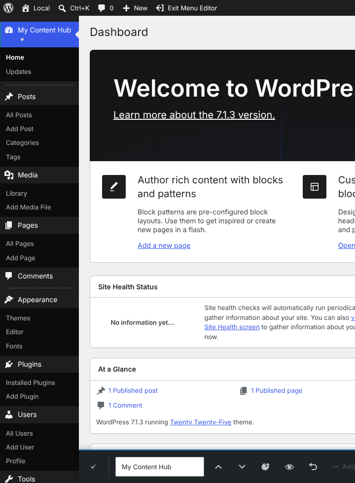
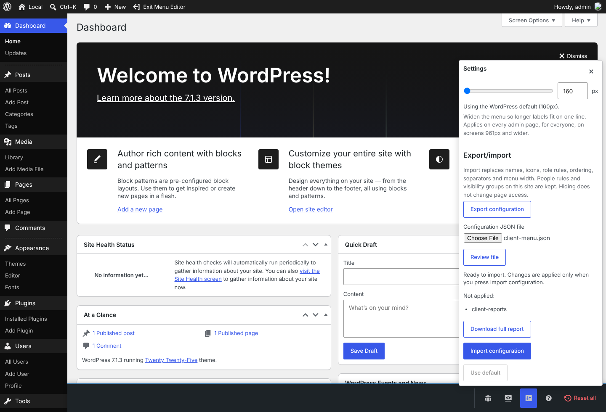
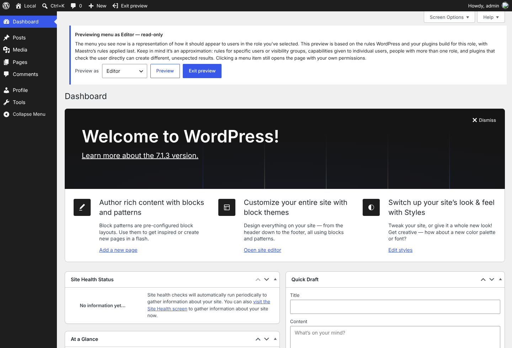

# Maestro

[](https://github.com/dknauss/Maestro/actions/workflows/ci.yml) [](https://github.com/dknauss/Maestro/tags) [](docs/)
[](https://www.gnu.org/licenses/gpl-2.0.html)
[](https://wordpress.org/)
[](https://wordpress.org/)
[](https://www.php.net/)
[](https://playground.wordpress.net/?blueprint-url=https://raw.githubusercontent.com/dknauss/Maestro/main/playground/blueprint-stable.json) [](https://playground.wordpress.net/?blueprint-url=https://raw.githubusercontent.com/dknauss/Maestro/main/playground/blueprint-hosted.json)
[](https://wordpress.org/plugins/maestro-menu-editor/)


In-place editing of the WordPress admin menu — rename items, reorder them, swap top-level icons, and hide items per role, per person or per visibility group. Preview the menu as a role, widen it, and copy a finished configuration to another site with export/import. Global configuration, no separate settings screen: the editor is toggled from the admin bar and operates on the menu itself.

**▶ [Try it live in WordPress Playground](https://playground.wordpress.net/?blueprint-url=https://raw.githubusercontent.com/dknauss/Maestro/main/playground/blueprint-stable.json)** — boots a throwaway site with the plugin active in edit mode, User Switching with a "Viewing as" admin-bar user switcher, and named test users (Adam Admin, Emma Editor, Andy Author, Carrie Contributor, Steven Subscriber; logins `editor` / `author` / `contributor` / `subscriber`, password `password`) so you can try per-role visibility by switching users. This demo installs the **latest released version**. ([Development build (main)](https://playground.wordpress.net/?blueprint-url=https://raw.githubusercontent.com/dknauss/Maestro/main/playground/blueprint-hosted.json) also available.)

## Try the new selected-row controls (prototype)

We are testing a different way to edit: when you pick a menu item, its
controls (rename, move up, move down and a **More** menu for visibility, reset
and separators) appear on the menu item itself instead of in the toolbar along
the bottom of the screen, and the item's icon becomes the button for choosing a
new one. It is a prototype on its own branch
([#261](https://github.com/dknauss/Maestro/pull/261)) and is not in a release
yet, so the released plugin and the demos above still use the bottom toolbar.

- **▶ [Open the prototype in WordPress Playground](https://playground.wordpress.net/?blueprint-url=https://raw.githubusercontent.com/dknauss/Maestro/proto/selected-row-controls/playground/blueprint-row-controls.json)** — a throwaway site in your browser, already in edit mode.
- **[Tester guide](https://newlocalmedia.github.io/guides/maestro-prototype-testing/)** — what changed, and five to ten minutes of things to try on a desktop, a phone or the keyboard. ([Copy on the prototype branch](https://github.com/dknauss/Maestro/blob/proto/selected-row-controls/docs/testing-row-controls-prototype.md).)
- **[Send feedback](https://github.com/dknauss/Maestro/issues/new?template=03-prototype-feedback.yml)** — a short form; every field but the first is optional, and screenshots are welcome.

## Screenshots

Click any screenshot to open the full-size image.

| Edit mode | Icon picker |
| --- | --- |
| [](.wordpress-org/screenshot-1.png) | [](.wordpress-org/screenshot-2.png) |
| Dashboard selected, with the editing toolbar along the bottom. | Searchable icon picker with Dashicons and Bootstrap Icons tabs. |

| Role visibility | Autosave |
| --- | --- |
| [](.wordpress-org/screenshot-3.png) | [](.wordpress-org/screenshot-4.png) |
| Visibility popover: hide from roles, named people or visibility groups. | Renamed menu item saved through debounced autosave. |

| Settings and export/import | Preview as a role |
| --- | --- |
| [](.wordpress-org/screenshot-7.png) | [](.wordpress-org/screenshot-8.png) |
| Settings: menu width, and export/import with a reviewed file. | The menu as an Editor sees it, under the read-only preview banner. |

Screenshots 5 and 6 (dragging a menu group, and the ▲/▼ move controls) are in
[`.wordpress-org/`](.wordpress-org/).

## Important: visibility is cosmetic, not access control

Hiding a menu item only declutters the menu — the underlying page still loads for anyone who knows its URL, because a page's own registered capability is the real lock. For actual access control, pair this with a capability manager ([User Role Editor](https://wordpress.org/plugins/user-role-editor/), or [PublishPress Capabilities](https://wordpress.org/plugins/capability-manager-enhanced/)). The `maestro_capability` filter lets such a plugin hand editing rights to a custom capability instead of the default `manage_options`.

## Quick start

1. Activate the plugin, then choose **Edit Menu** in the admin bar.
2. Click a menu item to select it. The shared controls panel opens beside the
   menu.
3. Rename an item by editing its label. Press `Enter` to commit or `Escape` to
   restore the previous label.
4. Reorder items by dragging menu rows. Top-level items reorder among top-level
   items; submenu items reorder inside their current parent. Separators are rows
   too: select one to move or remove it, or select a top-level item and choose
   **Add separator below** to start a new group.
5. Change a top-level icon from the icon picker. Use Dashicons, bundled
   Bootstrap Icons (about 440, grouped and searchable by admin topic), "No
   icon", or a valid WordPress icon value. SVG icons follow the menu's colours
   in every admin colour scheme.
6. Hide an item from selected roles with the visibility control. This only
   changes what those roles see in the menu; it does not block the page URL.
   **All other roles**, at the top of each role list, ticks every role you do
   not hold yourself in one go, so you can't hide the item from your own view
   by accident; use it again to clear them.
7. Hide an item from **named individuals** in the same popover — search for a
   person and add them. Useful when a role is the wrong unit (one person on a
   shared role who doesn't need a tool). A parent's sub-items can be hidden per
   person too, with the parent left visible. Same cosmetic-only guarantee: the
   page still loads by URL for anyone authorized to see it.
8. Hide items from a **named group of people** with a visibility group. Open
   **Visibility groups** in the toolbar, name a group ("Reduced view"), add
   people to it, then tick it in any item's visibility popover. Membership is
   read on every page load, so changing who is in a group updates every item
   it hides. A group is **not a role and not access control**: WordPress never
   sees it, it grants or removes no capability, and its pages still load by URL.
   If a role already matches the people you mean, use the role.
9. Widen the menu so longer labels fit: drag the handle on the menu's edge, or
   set an exact width under **Settings** (the gear in the toolbar). It
   applies on every admin page for everyone, from 961px wide (the handle and
   the gear only appear there), and stands aside
   when another plugin already sets the width.
10. Check the result with **Preview as** (the screen button in the toolbar):
    choose a role and press **Preview** to see the Dashboard with that role's
    menu, under a read-only banner. You stay signed in as yourself and nothing
    is saved.
11. Copy a finished menu to another site with export/import under
    **Settings**. Export downloads a versioned JSON file of names, icons, role
    rules, ordering, separators and menu width. On the destination, **Review
    file** lists anything that can't be applied before **Import configuration**
    changes anything. Rules for named people and visibility groups are never
    exported, and the destination keeps its own. See the
    [user guide](docs/user-guide.md#export-and-import-a-menu-configuration).
12. Use **Reset this item** to discard one item's customizations, or **Reset
    all** to delete the saved configuration and return to WordPress defaults.
13. Choose **Exit Menu Editor** in the admin bar when finished. Pending
    autosaves are flushed before the page reloads.

For the longer walkthrough, see [`docs/user-guide.md`](docs/user-guide.md).

## Status

**v1.11.0 is live on the WordPress.org plugin directory** ([maestro-menu-editor](https://wordpress.org/plugins/maestro-menu-editor/)). It adds a WordPress icon tab (WordPress 7.1+), safer separator editing, a notice when the browser runs old editor files and a lasting saved check to 1.10.0's export/import and colour-matched SVG icons (full history in the [changelog](readme.txt), roadmap in [`.planning/ROADMAP.md`](.planning/ROADMAP.md)). Every test layer is expected to stay green: PHP unit and integration tests, Playwright E2E, JavaScript unit tests, phpcs, PHPStan, and Plugin Check on the runtime build. The editor uses the click-to-select model with debounced autosave:

- **Debounced autosave (~500 ms)** on reorder, rename, icon pick, visibility toggle, and per-item reset — no manual Save button; a "Saving… / Saved" status indicator (dashicon + text) instead. Saves are serialized (single-flight) so a slow request can't overwrite newer edits. Reload only on Exit (which flushes any pending save) and on Reset all.
- **Click-to-select with one shared editing toolbar.** No edit chrome on the rows until an item is selected: each shows only a hover/focus-revealed drag handle. Selecting an item fills the toolbar along the bottom (rename, ▲/▼ move, icon picker for top-level items, visibility, reset-this-item, add separator), and its right side holds the menu-wide tools (visibility groups, Preview as, Settings, help tour, Reset all).

- **Visibility on six independent axes.** The popover carries hide-by-role, hide-by-person and hide-by-group, each in a "this item" and an "its sub-items" variant, so a parent can stay visible while its children vanish for exactly the roles or people you choose. The person picker searches core's `wp/v2/users` endpoint (already gated by `list_users`), so it scales past a few hundred users instead of dumping the whole user base into the page. A visibility group is a named, reusable list of people: the items it hides are compiled onto each item when saved, and who is in it is resolved live on every request, so membership changes need no re-save. Groups are authored only by users with `list_users`, and are withheld from everyone else server-side. Every axis is cosmetic: a hidden page still loads by URL, and `current_user_can()` is provably unchanged — asserted by a dedicated guardrail test that snapshots the target role's entire capability map before, during, and after a rule.
- **Stable expanded menu while editing.** Folded/auto-fold mode is neutralized on entry and re-stripped if `common.js` reapplies it, so editing always happens against the expanded menu.
- **Icons: all four native WordPress forms** (dashicon, `none`, base64 image data-URI, image URL), validated server-side. The picker bundles two sets in square, single-colour cells — all 342 dashicons and 437 curated [Bootstrap Icons](https://icons.getbootstrap.com/), grouped by admin topic and loaded the first time their tab opens — plus, on WordPress 7.1 and later, a WordPress tab listing every icon in core's icon registry (served on demand by `GET maestro/v1/icons`), with a search filter and a "No icon" option. It opens on the tab of the item's current icon, and is keyboard-accessible (dialog/tablist roles, arrow-key navigation, focus trap) and mobile-sized. A stored SVG icon is painted as a CSS mask, so it takes the menu's idle, hover and current colours in every admin colour scheme. Icon changes persist via autosave (covered by E2E: pick → POST carries the icon → survives reload).
- **Preview as a role.** A read-only Dashboard preview narrows your own capabilities to the chosen role for that request only, applies Maestro's rules for the role, and saves nothing. It is an approximation: person and group rules, per-user grants and multi-role users can differ.
- **Export/import.** A versioned, portable JSON file (format separate from the stored schema) carries names, icons, role rules, ordering, separators and width. Import is two-step: a read-only review reports what can't be applied, then an explicit import replaces only the portable settings. Person rules and visibility groups never leave the site and are preserved on the destination.

See [`SPEC.md`](SPEC.md) for the durable design and [`docs/archive/FIXES.md`](docs/archive/FIXES.md) for the historical fix log.

## Localization

The plugin uses the `maestro-menu-editor` text domain and ships a translation template plus starter language packs for Spanish (`es_ES`), German (`de_DE`), Japanese (`ja`), French (`fr_FR`), Portuguese (Brazil) (`pt_BR`), and Italian (`it_IT`). PHP-visible strings use WordPress translation helpers, and the editor receives its UI labels through the localized `maestroData.i18n` payload so JavaScript controls, dialogs, status messages, and button text are translatable. WordPress.org language packs can still override and extend the bundled catalogs; native-speaker and WordPress Polyglots review is welcome.

## Repository layout

- **Runtime plugin** — [`maestro-menu-editor.php`](maestro-menu-editor.php), `includes/`, `assets/`, `languages/`, `readme.txt`. This is all that ships to a site.
- **WordPress.org listing assets** — `.wordpress-org/` contains the directory icon ([`icon.svg`](.wordpress-org/icon.svg), `icon-128x128.png`, `icon-256x256.png`), banners (`banner-772x250.png`, `banner-1544x500.png`), and screenshots (`screenshot-1.png` through `screenshot-8.png`, regenerated with `npm run screenshots`; see [`TESTING.md`](TESTING.md#directory-screenshots)).
- **Dev & tooling** — `tests/`, [`composer.json`](composer.json), [`package.json`](package.json), [`.wp-env.json`](.wp-env.json), [`playwright.config.ts`](playwright.config.ts), `phpunit-*.xml.dist`, [`bin/build.sh`](bin/build.sh).
- **Docs** — [`docs/user-guide.md`](docs/user-guide.md) (user walkthrough), [`SPEC.md`](SPEC.md) (durable specification), [`TESTING.md`](TESTING.md) (how to run each test layer), [`docs/design/ui-standard.md`](docs/design/ui-standard.md) (editor UI standard), [`docs/performance/config-size-and-page-load.md`](docs/performance/config-size-and-page-load.md) (page-load measurements), and [`docs/archive/FIXES.md`](docs/archive/FIXES.md) (historical fix log).

## Footprint & performance

Maestro is deliberately lightweight. *Figures are a v1.10.0 snapshot from a static sweep; run [`bin/build.sh`](bin/build.sh) to re-measure the package.*

**Deployed package** ([`bin/build.sh`](bin/build.sh), with dev/test/tooling excluded): ~290 KB zip, ~1 MB installed. Of that, ~345 KB is the Bootstrap Icons set (a JSON file fetched only when its picker tab first opens) and ~100 KB is bundled translations.

| Runtime code | Approx. |
|---|---|
| PHP | ~5,600 LOC — 13 classes + bootstrap + uninstall (plus the generated dashicon list) |
| JavaScript | ~5,000 LOC — 4 files, unminified |
| CSS | ~1,650 LOC — 2 files |

**Storage** — one *non-autoloaded* `wp_options` row (`maestro_config`), created only on first save (a fresh install stores nothing). No custom tables, post/user meta, transients, or cron events. [`uninstall.php`](uninstall.php) deletes that single row — zero residue.

**Per-request query overhead**

- **Front end: 0 extra queries.** Every hook is admin-gated (the admin-bar node bails on `!is_admin()`), so the plugin is inert for public traffic.
- **Admin page: exactly 1 extra query** — a single non-autoloaded `get_option`, cached in-request by [`Config::get()`](includes/class-config.php) (one read no matter how many consumers) and served from the object cache after first read → **0 queries with a persistent object cache**. Not autoloaded, so it adds nothing to `alloptions`.
- **A stored menu width: 0 extra queries.** It reads the same cached config and adds one inline CSS rule to the always-loaded `maestro-admin-bar` stylesheet. Sites that never set a width get nothing.
- **Save: 1 `update_option`**, via the REST endpoint while actively editing. Rename/reorder/hide are applied by mutating the in-memory `$menu`/`$submenu` globals during `admin_menu` — no queries.

## Install (to a site)

Build a runtime-only zip and upload it under Plugins → Add New → Upload:

```bash
bin/build.sh        # writes build/maestro-menu-editor.zip (runtime files only)
```

Activate it; **Edit Menu** appears in the admin bar. Never ship the dev tooling inside the installed plugin.

## Develop & test

```bash
composer install && composer test:unit          # pure unit tests, no WordPress
npm install && npm run env:start                 # boot WordPress + MySQL (Docker)
npm run test:php                                 # PHP integration tests
npm run test:e2e                                 # Playwright end-to-end
```

See [`TESTING.md`](TESTING.md) for details and the standalone (non-Docker) paths.

## Playground demo (role testing)

A WordPress Playground blueprint ([`playground/blueprint.json`](playground/blueprint.json)) spins up a throwaway
site for trying the editor — including **per-role visibility** — without a local
WordPress. It installs [User Switching](https://wordpress.org/plugins/user-switching/)
plus a small demo-only must-use plugin that adds a "Viewing as" admin-bar menu
for one-click switching between the demo users, names the admin **Adam Admin**,
creates four named test users (**Emma Editor** `editor`, **Andy Author** `author`,
**Carrie Contributor** `contributor`, **Steven Subscriber** `subscriber`, all
password `password`), activates Maestro, and drops you into edit mode
as `admin`.

```bash
npm run playground
```

This builds the runtime-only plugin, mounts it into Playground, runs the
blueprint, and serves at `http://127.0.0.1:9400`. Hide a menu item from a role
in the editor, then use **Switch To** (admin bar) to view the menu as that user.

> **Hosted Playground:** two hosted blueprints are available, both served from `main` so their URLs are stable:
>
> - **[Latest release demo](https://playground.wordpress.net/?blueprint-url=https://raw.githubusercontent.com/dknauss/Maestro/main/playground/blueprint-stable.json)** — [`playground/blueprint-stable.json`](playground/blueprint-stable.json) installs the plugin from the latest GitHub release ZIP (`/releases/latest/download/`, through the Playground CORS proxy) — byte-identical to a release, and it always tracks the newest one. This is the primary "Try it live" link.
> - **[Development build (main)](https://playground.wordpress.net/?blueprint-url=https://raw.githubusercontent.com/dknauss/Maestro/main/playground/blueprint-hosted.json)** — [`playground/blueprint-hosted.json`](playground/blueprint-hosted.json) installs the current `main` build from the rolling `playground-demo` pre-release ZIP (`/releases/download/playground-demo/`, through the Playground CORS proxy), which CI refreshes on every push to `main`. Use this to preview unreleased changes.
>
> The local [`playground/blueprint.json`](playground/blueprint.json) mounts the working tree instead.

## Contributing

See [`CONTRIBUTING.md`](CONTRIBUTING.md) for local setup, quality gates, and pull request expectations. For security reports, use the private process in [`SECURITY.md`](SECURITY.md); do not open public security issues.

## License

GPL-2.0-or-later. See [`LICENSE`](LICENSE).
